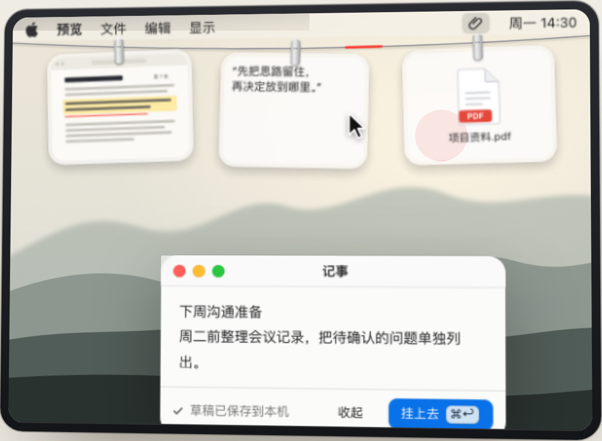
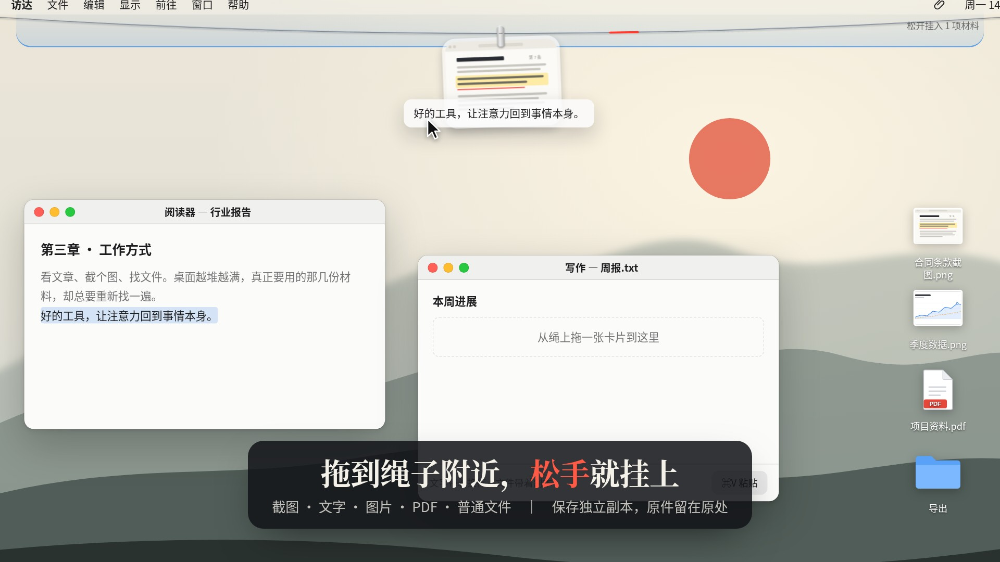
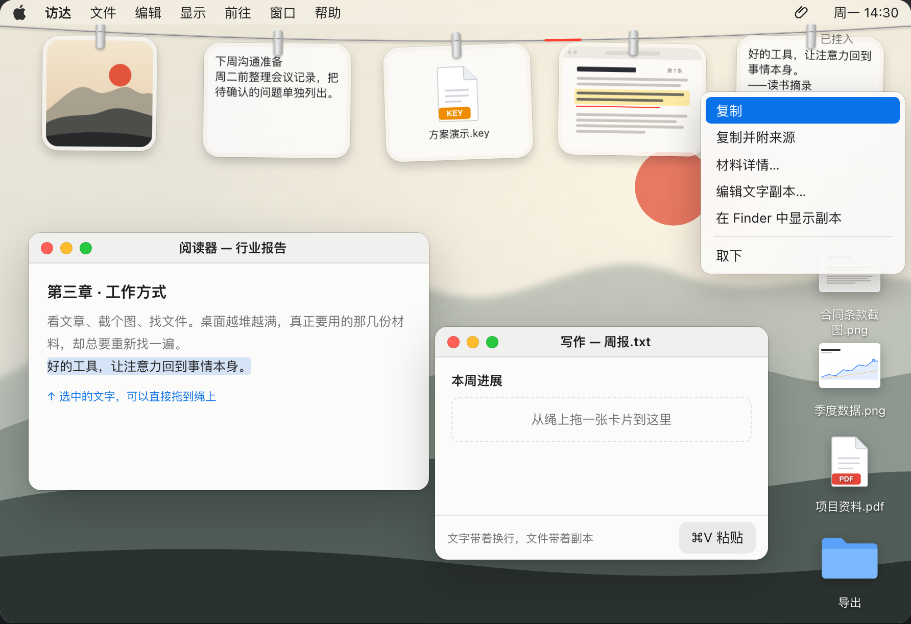
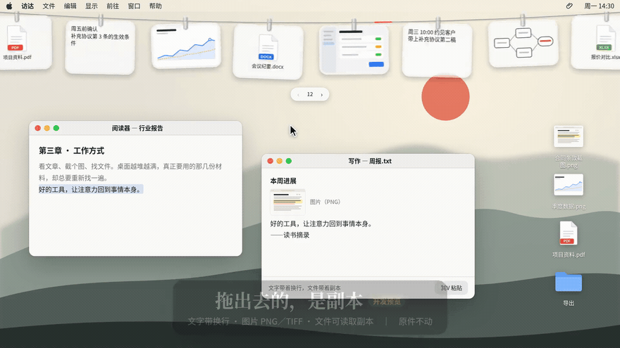
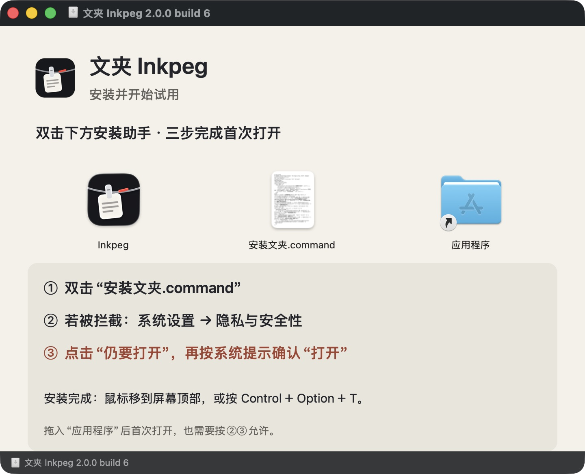

<h1 align="center">Inkpeg · 文夹</h1>

<p align="center">
  <b>让眼前的资料，一直在手边。</b><br>
  把截图、文字、图片、PDF 和文件挂在 Mac 屏幕上方的一根绳上。<br>
  随手复制、继续记事、拖出副本；材料保存在本机。
</p>

<p align="center">
  
  
  
  <a href="LICENSE"></a>
</p>

<p align="center">
  <a href="https://inkpeg.chenshi.ai/">产品网站</a> ·
  <a href="https://inkpeg.chenshi.ai/#download">下载与安装</a> ·
  <a href="https://inkpeg.chenshi.ai/#film">52 秒宣传片</a> ·
  <a href="README.zh-CN.md">详细使用指南</a> ·
  <a href="docs/inkpeg/KNOWN-ISSUES.md">本版限制</a>
</p>

<p align="center">
  <picture>
    <source media="(prefers-color-scheme: dark)" srcset="docs/assets/readme/overview-dark.png">
    
  </picture><br>
  <sub>官网网页交互的局部画面，非原生 App 截图。下文每张图、每段动图只解释对应功能。</sub>
</p>

> **第一次使用？** 从[下载与安装](#下载与安装)开始，再按[三步上手](#三步上手)挂入第一份材料。不必配置账号、模型或 API Key。

## 先看 52 秒

[](https://inkpeg.chenshi.ai/#film)

点击封面观看完整宣传片。下面的拖入、复制、记事、滚动和拖出章节各有独立动图，阅读时不用来回寻找整段视频里的操作。

## 它适合什么场景

| 你正在做的事 | 文夹怎么帮你 |
| --- | --- |
| 阅读报告、准备会议、整理合同或写文章 | 把几张截图、一段摘录和参考文件放在屏幕上方，切换窗口时仍能找到。 |
| 复制了一段话，还要继续复制其他内容 | 先把要保留的文字挂起来，用到时再复制，保留原有换行。 |
| 看资料时临时想到一句话 | 点小红段写记事，草稿留在本机；准备好后再挂成卡片。 |
| 把参考材料带到输入框或文件夹 | 复制文字、拖出图片或导出文件副本；原件仍在原处。 |
| 材料用完，需要整理空间 | 先取下卡片，再预览可清理副本，确认后移入系统废纸篓。 |

PDF、视频及普通文件按文件副本托管，不意味着文夹可以预览、识别或理解每一种格式。微信、Codex 等目标输入框的真实接收仍待验收；不能把网页演示当作跨应用兼容承诺。

## 三步上手

1. **挂入材料。** 把图片、文字或普通文件拖到屏幕顶部的绳子附近；也可从小红段右键菜单选择“粘贴挂入”或“挂入文件”。
2. **拿来使用。** 普通卡片单击复制，到目标窗口按 `⌘V`；记事卡单击继续编辑。需要文件时拖出副本。
3. **记下一句话。** 点小红段开始写，普通 Return 换行，`⌘Return` 或“挂上去”才发布为卡片；Esc 收起并保留草稿。

鼠标靠近屏幕顶部展开材料架，`⌃⌥T` 显示或隐藏。默认没有 Dock 图标。新工作区默认手动挂入，不会自动收集整个剪贴板。

## 1. 拖进来，就挂上

<p align="center"></p>

图片、文字和文件保存为独立副本，导入前的原件保留。卡片用于把当前工作的材料留在手边，不要求先创建项目或分类。

| 输入 | 当前边界 |
| --- | --- |
| 文字 | 单项最多 1 MiB，保留换行。 |
| 图片 | 单项最多 16 MiB、3200 万像素。 |
| 普通文件（含 PDF） | 单项最多 64 MiB；作为文件副本保存。 |
| 一批材料 | 最多 32 项／64 MiB；超限会拒绝并提示。 |

## 2. 单击复制，右键处理副本

<p align="center"></p>

普通卡片单击复制；**记事卡单击继续编辑**。右键可查看来源与详情、复制并附来源、打开副本、编辑支持的文字副本、标注支持的副本，或取下卡片。来源可以补录，应用不会凭空生成出处。

<p align="center">
  <picture>
    <source media="(prefers-color-scheme: dark)" srcset="docs/assets/readme/menu-dark.png">
    
  </picture>
</p>

## 3. 点小红段，随手记

<p align="center"></p>

无需单独填写标题，首行就是卡片标题。输入过程中保存本地草稿；收起后可以继续写，挂上后也能继续编辑同一张卡片。

- 普通 Return：换行。
- `⌘Return` 或“挂上去”：发布卡片。
- Esc、关闭或失焦：收起窗口，保留草稿。
- 空白内容或输入法尚在组合的文字：不会直接挂入。

留意保存状态。保存失败时保留窗口内容并提示，等重试成功再退出；强制结束不能保证最后一次尚未落盘的输入已经保存。

## 4. 挂满了，左右浏览

<p align="center"></p>

满绳后保留卡片，可以用触控板左右滚动、Shift＋鼠标滚轮或底部左右箭头查看。新挂入的卡片会进入可见范围，缩窄屏幕不会自动取下卡片。旧版本已经取下的资料不会自动重挂。

“最近取下”入口可把保留的副本重新挂回。完整历史管理、事项和双栏对照仍待完成，见[本版限制](docs/inkpeg/KNOWN-ISSUES.md)。

## 5. 拖出去的是副本

<p align="center"></p>

| 材料 | 拖出或复制的内容 |
| --- | --- |
| 文字／记事 | 纯文字，保留换行。 |
| 图片 | PNG／TIFF 和独立文件副本。 |
| PDF／普通文件 | 可读取的独立文件副本。 |
| Finder 文件夹 | 保留原生文件承诺方式，生成导出副本。 |

拖到桌面或文件夹会生成正常可见的副本，不继承来源的隐藏属性。拖出不移动原件，也不取下绳上的卡片。某些输入框不接收拖入时，先用“复制 → 目标应用 `⌘V`”。**微信／Codex 实际接收尚未完成验收。**

## 6. 需要时再开启自动接收

<p align="center">
  <picture>
    <source media="(prefers-color-scheme: dark)" srcset="docs/assets/readme/intake-dark.png">
    
  </picture>
</p>

从小红段右键菜单或回形针菜单进入设置。“挂入”页分别配置剪贴板接收类型、是否接收启动时已有内容，以及截图目录监听。

新工作区的自动接收默认关闭或未配置。开启后只接收所选类型；自行复制出去的内容和已经保存的重复内容不会再次建卡。截图目录里的旧文件不会补挂。剪贴板采用轮询，快速连续复制不能保证每一次变化都被接收。

## 7. 先预览，再清理

<p align="center">
  <picture>
    <source media="(prefers-color-scheme: dark)" srcset="docs/assets/readme/cleanup-dark.png">
    
  </picture>
</p>

“设置 → 存储 → 预览清理…”会列出已取下且未固定的副本，以及超过 24 小时的临时导出。确认后移入系统废纸篓。

原件、绳上／固定／待审资料及编辑／恢复草稿受保护。未知或损坏的恢复记录会保守阻止清理。**应用不自动清空废纸篓**；回收文件可以找回后重新挂入，旧卡片元数据不会自动恢复。

默认资料库是 `~/Library/Application Support/Inkpeg/`。升级前先正常退出，再备份**整个目录**，不要只备份 `state.json`，也不要让两份 App 同时使用同一资料库。

## 下载与安装

当前版本为 **2.0.0／build 6**，官网与本仓库的版本来源一致。[直接下载 Mac 通用版](https://inkpeg.chenshi.ai/downloads/Inkpeg-2.0.0-build6-universal.dmg)（大小见官网下载区），不需要 GitHub 登录。源码仓库目前私有，阅读仓库需要访问权限。

1. **打开安装包。** 下载后双击 DMG。
2. **双击安装助手。** 双击“安装文夹.command”；也可以把 App 拖入“应用程序”，再打开。
3. **被拦截时允许打开。** 先尝试打开一次，再进“系统设置 → 隐私与安全性”，向下找到 **“仍要打开”**，点击后按系统提示确认“打开”。拖入“应用程序”后的首次打开也按这一步操作。

安装完成后，鼠标移到屏幕顶部展开绳子，或按 `⌃⌥T`。新用户会看到三个产品示例：一份可编辑的介绍记事、一张官网宣传图、一份官网网页 PDF。它们可以取下，不会在重启后重新挂回；升级会保留原资料库。

<p align="center"></p>

安装包背景也印有上面的步骤。若希望用终端安装，可保持 DMG 打开，在官网展开“另一种安装方式”，复制命令到“终端”后回车：

```sh
/bin/bash "/Volumes/文夹 Inkpeg 2.0.0 build 6/安装文夹.command"
```

命令只运行包内本地助手。现代 macOS 可能要求确认粘贴，见 [Apple 官方说明](https://support.apple.com/zh-cn/127377)。未签名版本需要遵循系统确认提示。

DMG 仅三个入口：`Inkpeg.app`、“应用程序”快捷方式、`安装文夹.command`。版权、来源、说明和自动校验文件保留在 App 内部。助手先核对随包 App 的 SHA-256，只处理新安装的文夹 App；不关闭系统安全检查、不要求管理员密码。已有 App 会保留为带日期的旧版副本，资料库不改动。升级前正常退出旧版并备份完整资料库。详细说明见[安装与升级](docs/inkpeg/INSTALL.md)，[校验文件](https://inkpeg.chenshi.ai/downloads/SHA256SUMS.txt)可选核对。

## 版本与验证范围

2026-10-12 针对本次发布重新完成原生测试与 Universal 构建。包内版本、图标、资源和输入指纹均与本仓库一致。

| 范围 | 验证记录 | 边界 |
| --- | --- | --- |
| 原生应用 | **401／401**（Core 191＋App 210），零失败；[验证摘要](docs/inkpeg/VERIFICATION.md) | 自动测试不替代实体机器和跨应用操作。 |
| 安装助手 | **11 项**隔离回归；实际 DMG 安装、校验与资源检查 | 全新 Mac 的 Gatekeeper 提示仍待人工验收。 |
| 网站 | 实际浏览器交互、版本信息、DMG 下载 SHA 和视频章节检查 | 手机视口是浏览器模拟。 |
| README 图片与动图 | 官网组件的实际 Chromium 渲染和项目宣传片片段 | 网页画面，非原生 App 截图。 |

[发行元数据](https://inkpeg.chenshi.ai/downloads/release.json)、[构建输入](site/downloads/build-source.json)和[公开验证摘要](site/downloads/verification.json)保留可追溯信息。当前没有 Developer ID 签名／Apple 公证；Apple Silicon 本机已构建，Intel 实机、macOS 14、多屏、VoiceOver 和微信／Codex 接收仍待验收，见[本版限制](docs/inkpeg/KNOWN-ISSUES.md)。

隐私状态可持久保存，界面遮盖和异步回调保护已接通并有框架回归；真实屏幕合成和首帧体验仍需人工核验。

## 构建与工程

需要 macOS、Xcode 和 Python 3；Swift 工程没有第三方包依赖。仓库版本来源为 `packaging/release-version.json`。

```bash
# 验证目录必须是尚不存在的新目录。
scripts/verify-inkpeg.sh /tmp/inkpeg-new-verification
```

这个入口执行发行契约检查、完整 Swift 测试、两种架构的独立 Release 构建和 DMG 打包，保留命令、输出和退出码；不会替你安装或更改系统安全设置。只运行部分流程时：

```bash
DEVELOPER_DIR=/Applications/Xcode.app/Contents/Developer swift test
DEVELOPER_DIR=/Applications/Xcode.app/Contents/Developer scripts/build-inkpeg.sh --configuration release --no-sign
DEVELOPER_DIR=/Applications/Xcode.app/Contents/Developer scripts/package-inkpeg.sh --app /path/to/Inkpeg.app --output /path/to/new-directory
```

构建输入记录包括 pre-commit HEAD 和实际内容指纹，覆盖全部 Sources（包括未跟踪源文件）、版本、品牌、三份产品示例及明确的构建／包内说明输入；排除生成文件和系统元数据。发布后的提交 ID 可以变化，输入内容 SHA 应仍一致，详见[验证与追溯说明](docs/inkpeg/VERIFICATION.md)。

| 目录 | 职责 |
| --- | --- |
| `Sources/InkpegCore/` | 材料、版本、草稿、接收、恢复与清理核心。 |
| `Sources/Tendedero/` | 原生界面与系统适配；保留上游源码目录名。 |
| `Tests/` | 使用合成材料的核心与原生回归测试。 |
| `scripts/` | 构建、打包、资源与发行检查。 |
| `packaging/` | 版本来源、原创品牌、纯模拟的首次使用示例、随包说明和来源声明。 |
| `site/` | 产品网站、宣传片与当前发行元数据；生产包按白名单单独部署。 |
| `docs/assets/readme/` | 本文按功能组织的局部图片、动图片段与来源清单。 |
| `docs/inkpeg/` | 使用、限制、验证与历史工作记录。 |

## 来源、致谢与许可

文夹基于 Alejandro Buján 开源的 [Tendedero](https://github.com/alejandrobujan/tendedero)，固定上游提交 `3c866d94d25ee9d1e008aecd9a78a4e9b2bf06a4`。保留原作者版权与完整 [MIT 许可证](LICENSE)，新增代码沿用 MIT；[上游 README 原文](README.upstream.md)保留作历史说明。

产品名称、暖纸／弯绳／红夹视觉和本文媒体由本项目独立制作，不使用上游图标或演示图作为文夹发行资产，不暗示原作者背书。配乐为项目代码合成的原创曲目。[来源与致谢](packaging/来源与致谢.txt) · [chenshi.ai](https://chenshi.ai)。

MIT 不强制公开源码，也允许商业使用和仅分发安装包；分发时保留版权声明及完整许可。上游名称、Logo 和文档媒体有独立限制，本项目使用自己的品牌和宣传素材。
