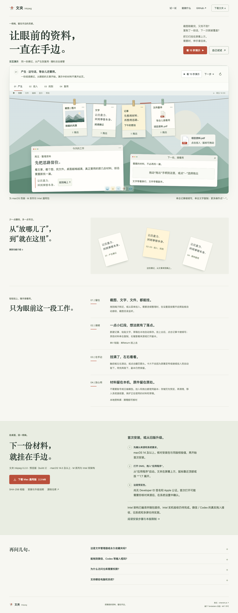
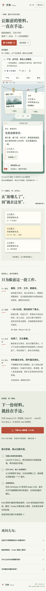

# Inkpeg · 文夹

Keep screenshots, text, images, PDFs and files on a rope at the top of your Mac. Browse, copy, drag out a copy, or continue a note without losing the material you were working with. Built with Swift, AppKit and SwiftUI; materials stay on your Mac.

**0.2.0 preview · build 2 · macOS 14.0 or later · Universal (Apple Silicon + Intel).** This candidate has no Developer ID signature or Apple notarization. Intel hardware and macOS 14 hardware remain unverified. See the [current verification record](docs/inkpeg/VERIFICATION.md) for measured results and limits.

[中文使用说明](README.zh-CN.md) · [Installation and upgrade guide (Chinese)](docs/inkpeg/INSTALL.md) · [Known limits](docs/inkpeg/KNOWN-ISSUES.md)

## Website and download

The release website is prepared for [inkpeg.chenshi.ai](https://inkpeg.chenshi.ai/), using GitHub `main` → Cloudflare Pages with `site/` as the publishing directory. Deployment is a separate final gate; this candidate's preparation does not assert that the site is already live. The source repository remains private and requires access.

The [versioned Universal DMG](site/downloads/Inkpeg-0.2.0-build2-universal.dmg), [SHA-256 checksum](site/downloads/SHA256SUMS.txt), [release metadata](site/downloads/release.json) and [portable verification summary](site/downloads/verification.json) travel together. The previous GitHub 0.1.0 release is historical and does not contain these changes.

Open the DMG, read the included guide, and copy `Inkpeg.app` into Applications. Launch that copy. For a trusted app blocked because it is unnotarized, follow [Apple's official instructions](https://support.apple.com/zh-cn/102445) in System Settings → Privacy & Security. Do not treat a damaged-app or malware warning as merely a signing issue. A matching SHA only establishes file consistency.

## What it does

- Hang a copy of an image, text, PDF or ordinary file; originals stay in place. Clipboard and screenshot-folder collection are optional and off or unset in a new workspace.
- Click the red rope segment to write. Drafts save locally; `⌘Return` hangs a note. Click a note to continue editing; other cards copy on click.
- Keep every card when the rope is full. Browse horizontally with the trackpad, Shift + wheel or arrows. Recently taken-down materials can be hung back explicitly.
- Drag out plain text, PNG/TIFF or a readable file copy. Actual WeChat/Codex input reception is **not verified**; copy and `⌘V` remain the fallback.
- Preview cleanup before moving eligible copies to the system Trash. Originals, active/pinned materials and editing/recovery drafts are protected.
- Persist privacy mode and cover material windows. Framework tests cover the data and callback boundaries; physical desktop compositing and VoiceOver remain unverified.

## Real website previews

These are freshly captured Chromium renders of the final candidate website, including its final version metadata. They show the interactive web demonstration, not a native Mac screenshot. The phone image is browser touch emulation, not a physical-device test.





## Data and upgrades

The library is `~/Library/Application Support/Inkpeg/`. Quit the app and back up the **whole folder** before upgrading; replace the application and preserve the library. Do not run two copies against it. The app has no account or cloud-model requirement and no business network feature; a complete runtime network audit is still pending.

## Build and verification

Requires macOS, Xcode and Python 3. There are no third-party Swift package dependencies. Version, build and minimum system come from `packaging/release-version.json`.

```sh
scripts/verify-inkpeg.sh /tmp/inkpeg-new-verification
```

The directory must be new. The entry point retains commands, exit codes and local logs, runs the full native suite, builds both slices in fresh scratch directories and creates a DMG. It does not install or change security settings. Follow the [verification handoff](docs/inkpeg/VERIFICATION.md) for mounted-image checks and the final website gate. Browser checks require an already installed Python Playwright/Chromium.

`build-source.json` records the pre-commit HEAD **and** a complete, sorted content fingerprint of actual build inputs, including new/untracked Sources. The same record is inside the app and the website download directory. It excludes generated outputs and OS metadata. A later publication commit need not cause a circular rebuild merely to embed its own commit ID.

## Project layout

| Directory | Purpose |
| --- | --- |
| `Sources/InkpegCore/` | Materials, versions, drafts, intake and cleanup. |
| `Sources/Tendedero/` | Native UI and platform adapters; upstream path retained. |
| `Tests/` | Native and core regression tests with synthetic fixtures. |
| `scripts/` | Build, packaging and verification tools. |
| `site/` | Static product site, versioned download and public verification summary. |
| `packaging/` | Version source, original brand assets, package guides and attribution. |
| `docs/assets/` | Final rendered website screenshots. |
| `docs/inkpeg/` | Current docs and explicitly historical plans/audits; raw records are not bulk published. |

## Credits and license

Based on Alejandro Buján's [Tendedero](https://github.com/alejandrobujan/tendedero), fixed upstream commit `3c866d94d25ee9d1e008aecd9a78a4e9b2bf06a4`. Original copyright and [MIT license](LICENSE) are retained. The [upstream README](README.upstream.md) is historical upstream documentation, not a current Inkpeg feature or release promise.

Inkpeg uses its own name and rope/paper/red-clip mark from `site/assets/mark.svg`, rendered into the app icon by `scripts/make-icon.swift`. Upstream icons and demonstration images are not distributed as Inkpeg assets; no endorsement is implied. [Attribution](packaging/来源与致谢.txt) · [chenshi.ai](https://chenshi.ai).
