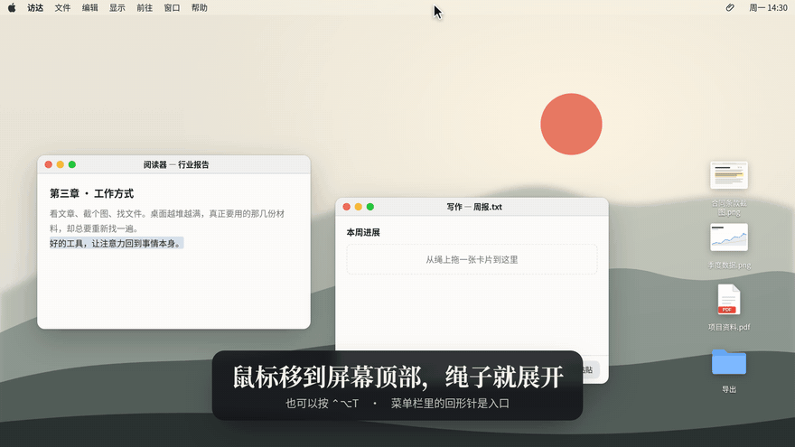
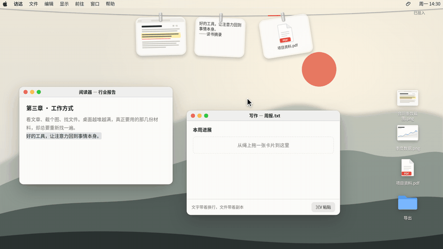
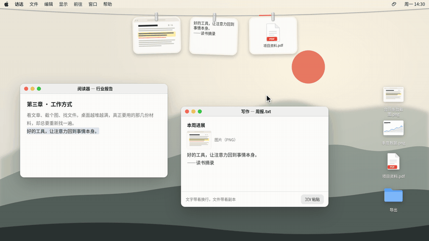
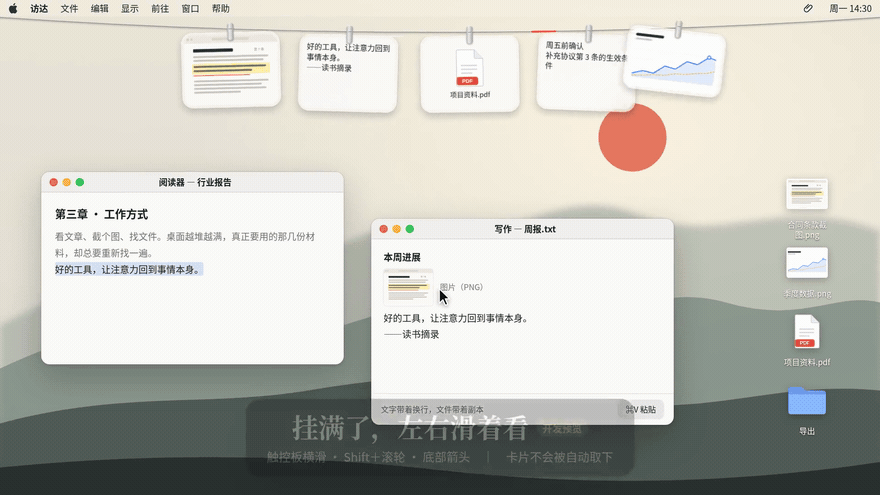
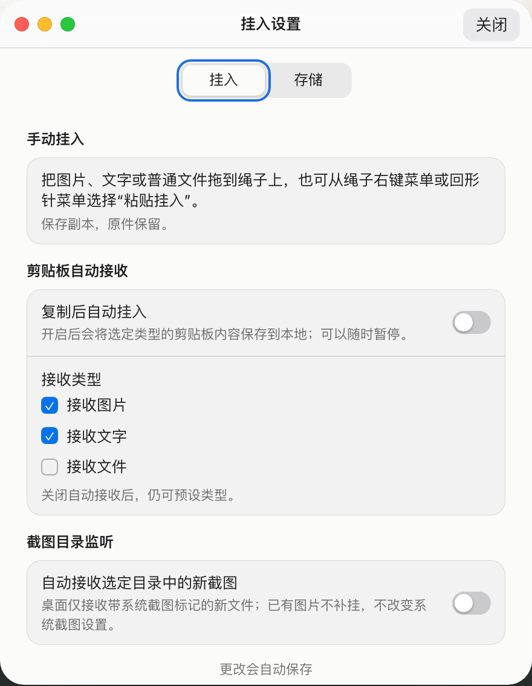
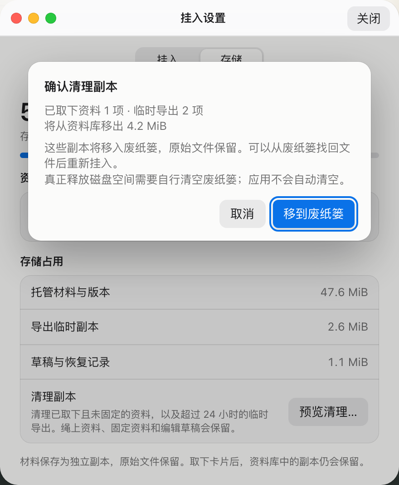

# 文夹 Inkpeg · 详细使用指南

[项目介绍](README.md) · [官网与下载](https://inkpeg.chenshi.ai/#download) · [本版安装说明](docs/inkpeg/INSTALL.md) · [已知限制](docs/inkpeg/KNOWN-ISSUES.md)

本指南解释常用操作、资料保护和遇到问题时的处理方法。图示取自官网网页交互的**局部画面与单动作动图**，不包含整页网站截图，也不冒充原生 App 截图。

> **当前版本 2.0.0／build 3。** 官网安装包与仓库版本一致。按下面三步安装，再挂入第一份材料。

## 按你的任务找操作

| 你想做什么 | 从哪里开始 |
| --- | --- |
| 首次安装，或更新旧版 | [安装与升级](#1-安装与升级) |
| 放一份图片、摘录或文件到绳上 | [挂入材料](#2-挂入第一份材料) |
| 找回正在使用的材料、放到别的窗口 | [复制与拖出](#3-查看复制与拖出副本) |
| 记下一句话，并在稍后继续 | [记事与草稿](#4-记事与草稿) |
| 绳子放不下更多卡片 | [满绳浏览与取下](#5-满绳浏览取下与挂回) |
| 按需要接收剪贴板或新截图 | [自动接收](#6-设置自动接收) |
| 回收不再需要的副本 | [存储与清理](#7-存储与清理) |
| 备份、回退或卸载 | [资料库与备份](#9-备份回退与卸载) |
| 无法打开、看不到绳子或拖入失败 | [常见问题](#10-常见问题) |

## 1. 安装与升级

### 第一次安装

1. 在[官网](https://inkpeg.chenshi.ai/#download)下载，双击打开 DMG。
2. 双击包里的 `安装文夹.command`，在终端按回车确认，等待“安装完成”。
3. 鼠标靠近屏幕顶部展开文夹，或按 `⌃⌥T`，把材料拖到绳子附近。

安装助手被系统拦截时：先尝试打开一次，再到“系统设置 → 隐私与安全性”点击“仍要打开”，然后重新运行助手并按提示确认。助手只处理刚安装的文夹 App，不改变全局系统安全设置。

更多说明见[安装与升级](docs/inkpeg/INSTALL.md)。

### 更新已有版本

先等草稿保存完成，处理编辑和恢复提示，从回形针菜单选择“退出”。备份整个 `~/Library/Application Support/Inkpeg/`，保留旧 App 作为回退，再安装新版。

**只更换应用，保留资料库。** 不要同时运行两份 App，不要只备份或替换 `state.json`。安装后检查既有卡片、草稿和接收设置；没有自动更新功能。

## 2. 挂入第一份材料

将图片、文字或本地文件拖到屏幕顶部绳子附近的高亮区域，松手挂入。也可以：

- 先复制文字或图片，再右键小红段／打开回形针菜单，选择“粘贴挂入”。
- 用“挂入文件”选择本地文件。
- 点小红段创建一份记事，写好后挂上去。

导入保存独立副本，原件留在原来的位置。新工作区默认手动挂入，不会接收整个剪贴板。文字单项上限 1 MiB；图片 16 MiB／3200 万像素；普通文件 64 MiB；每批 32 项／64 MiB。超限会拒绝并提示。

PDF、视频等作为普通文件托管。能够接收不代表能预览、识别或理解其内容。

## 3. 查看、复制与拖出副本

普通材料单击复制，到目标应用按 `⌘V`；**记事卡单击继续记事**。右键卡片可以查看来源与详情、复制并附来源、打开导出副本、编辑支持的文字副本、标注支持的副本，或取下。

来源名称、网址与页码可按实际资料补录，不会凭空生成原始出处。打开和编辑针对副本，原件与原始摘录保留。

拖出时：文字／记事提供纯文字并保留换行；图片提供 PNG／TIFF 和独立文件副本；PDF／普通文件提供可读取副本；Finder 的原生文件承诺方式保留。拖出不取下卡片，不移动原件。

**微信／Codex 真实接收仍待验收。** 某个输入框不接收时，先用“复制 → 目标应用 `⌘V`”。网页写作窗口只是交互演示，不会替你打开本机应用。

## 4. 记事与草稿

点击小红段打开记事窗口。支持键入和纯文字 `⌘V`，无需另填标题，首行用作卡片标题。

| 操作 | 结果 |
| --- | --- |
| 普通 Return | 正文换行。 |
| `⌘Return`／“挂上去” | 将正文发布为卡片。 |
| Esc、关闭或失焦 | 收起记事窗口并保留草稿。 |
| 再点小红段 | 恢复未挂出的草稿。 |
| 单击已有记事卡 | 继续编辑同一张记事卡。 |

空白正文和输入法尚在组合的文字不会挂入。输入过程中保存草稿，但应留意保存状态；保存失败会保留窗口内容并提示，等重试成功后再退出。崩溃或强制退出不能保证最后一次尚在写入的输入已经落盘。

本版允许选择多份草稿；如窗口出现草稿选择入口，切换前留意当前保存状态。恢复提示应先处理，未知恢复记录会保守阻止清理。

## 5. 满绳浏览、取下与挂回

卡片超过屏幕宽度后，仍留在绳上：

- 触控板左右滚动，或按住 Shift 使用鼠标滚轮。
- 使用底部左右箭头翻页，到两端自动停止。
- 新材料进入可见范围；屏幕变窄不会自动取下卡片。

“取下”只从绳上隐藏卡片，副本仍在资料库。旧版已取下的资料不会自动重挂。本版提供“最近取下”入口，可主动选择挂回；完整历史管理尚未实现。

## 6. 设置自动接收

  <picture>
    <source media="(prefers-color-scheme: dark)" srcset="docs/assets/readme/intake-dark.png">
    
  </picture>

从小红段右键菜单或回形针菜单进入“设置 → 挂入”。

**剪贴板接收：** 按需开启图片、文字或文件，单独决定是否接收启动时已有的内容。自行复制出去和已经保存的重复内容不会再次建卡。快速连续复制可能落在轮询间隔内，不能保证接收每一次变化。

**截图目录：** 桌面仅接收有系统截图标记的新图片；专用目录可接收其他截图软件新保存的图片。已有文件不会补挂。文夹不会接管或修改系统截图保存设置。

新工作区默认手动接收；需要自动收集某类内容时再启用对应项。资料库位置当前固定，不支持在设置中自定义。

## 7. 存储与清理

  <picture>
    <source media="(prefers-color-scheme: dark)" srcset="docs/assets/readme/cleanup-dark.png">
    
  </picture>

打开“设置 → 存储 → 预览清理…”，逐项检查名称、数量和占用，确认后再移到废纸篓。

| 默认可预览清理 | 受保护内容 |
| --- | --- |
| 已取下且未固定的托管副本 | 导入前的原件、绳上／固定／待审材料。 |
| 超过 24 小时的临时导出 | 编辑／恢复草稿、未知或损坏恢复记录涉及的材料。 |

预览后材料发生变化时，旧确认会被拒绝，应重新预览。某些尚在编辑的内容会保守保留；没有列出的项目不要自行删除。

清理是**移到系统废纸篓**，应用不会自动清空。真正释放空间需要你自行清空；清空后不能通过文夹恢复。回收文件可从废纸篓找回后重新挂入，旧卡片元数据不会自动重建。清理记录继续保留，因此清理小文件后总占用可能短暂增加。

## 8. 本版的一键隐私

回形针菜单提供隐私切换；状态持久保留，隐藏材料窗口，并阻止旧的异步回调重新展示材料。持久化失败会提示，可在菜单重试。

框架测试覆盖数据与回调边界，但真实桌面首帧、屏幕合成效果与 VoiceOver 尚待验收。已经交给剪贴板、系统拖放或外部应用的内容，之后隐藏不能撤回。物理遮盖未完整验收，不能把它当作全部屏幕场景的保密保证。

## 9. 备份、回退与卸载

默认资料库：`~/Library/Application Support/Inkpeg/`。

| 内容 | 用途 |
| --- | --- |
| `Materials/` | 材料与版本；导入前原件在原来的位置。 |
| `Exports/` | 复制、外部打开等生成的临时导出副本。 |
| `Drafts/`、`Transactions/` | 草稿及编辑恢复记录。 |
| `CleanupRecords/` | 清理清单、过程状态和废纸篓结果。 |
| `state.json`、`state.previous.json` | 当前与备用状态及设置。 |

备份前正常退出，复制**整个资料库目录**并加日期。不单独删状态文件，不只恢复一部分目录。发现未知或损坏记录时，保留原目录并反馈，不自行清空或重建。

回退前先退出新版，保留当前新增材料，再更换为保留的旧 App。旧版是否能读取之后的新资料库，要看对应版本说明；恢复备份时若原位置已有同名资料库，应停止，不能直接覆盖合并。

卸载时正常退出，把 `Inkpeg.app` 移到废纸篓，资料库仍保留。若还要移除资料，先完整备份并确认不再需要，再把整个资料库移到废纸篓；不自动清空废纸篓，导入前原件不受影响。

## 10. 常见问题

| 现象 | 先做什么 |
| --- | --- |
| 打开后看不到绳子 | 鼠标靠近屏幕顶部，或按 `⌃⌥T`；确认没有同时运行旧版。无 Dock 图标是菜单栏应用的正常行为。 |
| 装了新版，还是旧界面 | 先正常退出旧副本，再从“应用程序”启动目标版本；不要从旧开发路径或 DMG 中运行。 |
| 拖到输入框没有反应 | 用菜单复制后到目标窗口 `⌘V`；记录系统、目标应用版本和材料类型。真实接收待验收，不附上私密材料。 |
| 清理预览里没有内容 | 绳上、固定、待审、近期导出与编辑／恢复草稿通常受保护；先核对状态。 |
| 暂时无法清理 | 先处理待恢复内容；未知／损坏记录会保守停止，保留原目录。 |
| 清理后磁盘空间没有减少 | 内容仍在废纸篓，真正释放空间需要你自行清空；清理记录也会占少量空间。 |
| 系统提示损坏或恶意软件 | 停止打开，重新核对来源、同版 SHA-256 和提示；不直接用安全设置绕过。 |
| Intel／旧 macOS 能否使用 | 包含 Intel 架构、工程最低 macOS 14；对应实机、Gatekeeper 与平台矩阵仍待验收。 |

## 版本、证据与来源

本次发布重新运行了 **391／391** 原生测试（Core 181＋App 210）、7 项安装助手回归与网站交互检查。详细范围见[验证摘要](docs/inkpeg/VERIFICATION.md)、[发行元数据](site/downloads/release.json)、[实际构建输入](site/downloads/build-source.json)和[公开验证摘要](site/downloads/verification.json)。自动验证不能替代尚未完成的实体机器与跨应用测试。

官网 2.0 的安装方法、限制与校验文件均在其[下载区](https://inkpeg.chenshi.ai/#download)。跨应用接收、Intel／macOS 14 实机、多屏／全屏、睡眠／重启、完整中文输入法、VoiceOver、实体触控板、Safari／Firefox、实体手机、Finder／应用切换器、Gatekeeper 与完整 GUI 升级都有明确未验收边界。

[来源与致谢](packaging/来源与致谢.txt) · [MIT 许可证](LICENSE) · [上游原文](README.upstream.md) · [chenshi.ai](https://chenshi.ai)。
